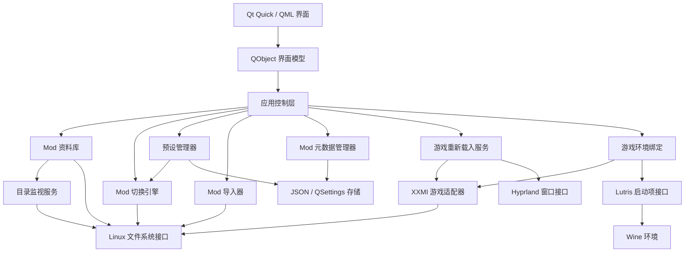

# RLSM 项目规划

RLSM（Rainy Linux Skin Manager）是面向 Linux 和 XXMI 的多游戏 Mod 管理器。项目预留 GIMI、SRMI、WWMI、ZZMI、HIMI 和 EFMI 六个官方模块定义，当前首先连接绝区零的 ZZMI，并为终末地的 EFMI 保留游戏与启动环境接口。

## 技术方案

- Python 负责文件系统操作、业务逻辑和 XXMI 集成。
- PySide6 提供 Qt 6 的 Python 接口。
- Qt Quick 与 QML 负责角色卡片、Mod 图片网格、预设和设置界面。
- QFileSystemWatcher 监视外部目录变化，QThreadPool 执行扫描、导入和图片读取。
- QSettings 与 QStandardPaths 按照 Linux XDG 目录保存应用设置。
- sqlite3 读取 Lutris 的 `pga.db`，PyYAML 读取游戏与运行器配置。
- pathlib、json、zipfile、tempfile 和 shutil 完成路径、配置与 ZIP 导入。
- libarchive 负责后续增加的 7z 和 RAR 导入。
- pyside6-deploy 负责生成 Linux 独立程序。

## 组件关系

## 核心模块

### 游戏适配器

每个适配器描述游戏名称、XXMI 模块目录、Mods 目录、游戏程序、进程特征、注入方式和重新载入方式。共用服务只依赖适配器接口，不包含绝区零专用路径。

预留的官方模块包括：

- GIMI：原神。
- SRMI：崩坏：星穹铁道。
- WWMI：鸣潮。
- ZZMI：绝区零。
- HIMI：崩坏3。
- EFMI：明日方舟：终末地。

模块接口识别以下内容：

- XXMI 根目录和当前模块目录。
- `Mods`、`d3dx.ini` 与 `d3dx_user.ini`。
- `include_recursive = Mods` 和 `exclude_recursive = DISABLED*`。
- 游戏程序、实际游戏进程与 Hyprland 游戏窗口。
- XXMI 的 HOOK 或 DIRECT 注入方式，以及游戏要求的 DirectX 参数。

终末地使用 EFMI 定义，程序名称为 `Endfield.exe`，DirectX 参数为 `-force-d3d11`。安装 EFMI 后无需修改 Mod 切换引擎。

### 游戏环境绑定

- `GameDefinition` 保存游戏程序、进程、安装目录特征与 Lutris slug。
- `ImporterDefinition` 保存 XXMI 模块目录、注入方式、Mods 目录和 DirectX 参数。
- `LaunchProfile` 保存 Lutris 条目编号、执行目标、参数、工作目录和启动 URI。
- `WineEnvironment` 保存 Wine 前缀、运行器、架构和环境变量。
- `GameBinding` 为每个游戏保存模块目录、Lutris 启动项和可选的 Wine 前缀覆盖值。
- 自动匹配优先使用 Lutris 参数中的 `--xxmi`，其次使用 slug 和执行文件名称；用户选择的绑定单独保存。

### Lutris 与 Wine

- 从 `~/.local/share/lutris/pga.db` 读取已经安装的启动项。
- 从 `~/.local/share/lutris/games/*.yml` 读取执行目标、参数、Wine 前缀和单独运行器设置。
- 游戏配置没有运行器版本时，继续读取 `~/.local/share/lutris/runners/<运行器>.yml`。
- 启动项缺少 Wine 前缀时，允许用户为当前游戏单独选择已有前缀。
- 启动游戏时使用 `lutris:rungameid/<ID>`，由 Lutris 继续处理 Wine、Proton、UMU 和环境变量。

### Mod 资料库

- 递归扫描适配器提供的 Mods 目录。
- 根据 `DISABLED` 前缀判定启用状态。
- 识别分类目录、角色目录、Mod 目录和预览图片。
- 维护供界面搜索、筛选和统计使用的内存索引。
- 合并 QFileSystemWatcher 产生的连续事件，重新扫描受影响目录。

### Mod 切换引擎

- 停用时把 `MyMod` 重命名为 `DISABLED_MyMod`。
- 启用时移除目录名称开头的 `DISABLED_`。
- 操作前检查同名目录、目录权限和目标状态。
- 单选切换先计算同组需要停用的其他 Mod。
- 批量操作中途失败时，按照已完成的步骤反向重命名。
- 成功后更新资料库并按需请求游戏重新载入。

### 预设管理器

- 保存全局预设和指定角色预设。
- 使用 Mod UUID 与规范化相对路径识别 Mod。
- 应用前生成启用、停用、缺失和冲突清单。
- 调用同一个 Mod 切换引擎执行批量操作。
- 把预设保存在 XDG 数据目录的 `profiles` 子目录。

### Mod 元数据管理器

- 管理 UUID、自定义名称、作者、来源地址、预览图片、所属角色和导入时间。
- 支持可选的 `.rlsm.json`，缺少元数据的 Mod 仍可扫描和切换。
- 读取已有 `.JASM_ModConfig.json` 时只做兼容导入。

### Mod 导入器

- 接收目录、ZIP、7z 和 RAR。
- 在临时目录解压并定位实际 Mod 根目录。
- 检测多 Mod 压缩包，选择或推断目标角色。
- 对同名目录提供替换、保留两份和取消操作。
- 导入完成后生成元数据并刷新资料库。

### 游戏重新载入服务

- 检查适配器描述的游戏进程。
- 通过 Hyprland 后端定位游戏窗口并发送 F10。
- 游戏未运行时只完成目录切换。
- 窗口控制不可用时提示用户手动重新载入。

## 界面页面

- 游戏环境：选择游戏、XXMI 模块、Lutris 启动项和 Wine 前缀，显示两部分检查结果。
- 角色总览：显示角色图片、Mod 数量和启用数量。
- Mod 管理：提供图片网格、搜索、筛选、单选和多选切换。
- 预设管理：保存、预览和应用预设。
- Mod 导入：显示解压、识别、冲突处理和导入进度。
- 设置：管理重新载入、界面、目录监视和默认导入行为。

## 代码结构

- `src/rlsm/domain/`：Mod、游戏、XXMI 模块、Lutris 启动项、Wine 环境、预设与操作结果模型。
- `src/rlsm/application/`：扫描、切换、预设与导入流程。
- `src/rlsm/infrastructure/`：文件系统、XXMI、Lutris、Wine、Hyprland、存储与压缩包实现。
- `src/rlsm/presentation/`：提供给 QML 的 QObject 界面模型。
- `src/rlsm/qml/`：页面、卡片、对话框与通用控件。
- `src/rlsm/resources/`：游戏资料、默认图片、图标和翻译。

## 实现阶段

1. 建立 PySide6/QML 可启动项目和应用设置。
2. 完成游戏适配器、XXMI 环境识别、Lutris 与 Wine 绑定、Mod 扫描和目录切换。
3. 完成角色总览、Mod 管理和操作结果提示。
4. 完成预设保存、预览、应用与失败恢复。
5. 完成目录和压缩包导入。
6. 完成目录监视、Hyprland 重新载入与 Linux 独立程序打包。
